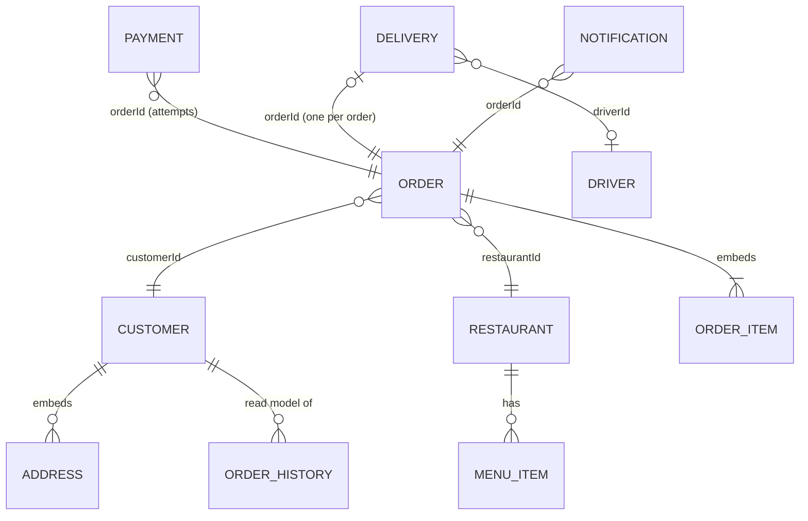

# Database Design

How each service stores its data, and why.

## Principles

1. **Database per service.** Each service owns its data, and no service reads or writes another service's database. MongoDB runs as one server in Docker Compose, but every service has its own logical database (`order_service`, `customer_service`, …). The Payment Service has a separate PostgreSQL server. In production, each database could move to its own server without code changes, because only the connection settings in `Config.toml` would change.
2. **Reference by ID, never by foreign key across services.** An order stores `customerId` and `restaurantId` as plain strings. No database enforces them, because those records live in other services' databases. Each ID is a UUID generated by the owning service.
3. **Share data through events, not queries.** When a service needs another service's data, it keeps its own copy built from Kafka events. This is a *read model*, as in CQRS. Examples are the Customer Service's `order_history`, the Admin Service's `orders`, and the Notification Service's `order_customers`. If the source service is down, the copy can still be read.
4. **Idempotent writes.** Kafka delivers at least once, so every write driven by an event is either an **upsert keyed on a unique business ID** or guarded by a **unique index**. Processing the same event twice therefore changes nothing.
5. **Optimistic concurrency for state machines.** Status changes include the expected current status in the update filter, for example `{orderId, status: "CONFIRMED"}`. If two updates race, only one matches and the other gets a conflict instead of silently overwriting.
6. **Indexes follow the queries.** Every lookup the APIs and consumers perform is backed by an index, and the sorted lists use compound indexes.

## Overview

| Service | Store | Database | Collections / tables | Source of truth for |
|---|---|---|---|---|
| Customer | MongoDB | `customer_service` | `customers`, `order_history` | customers, addresses |
| Restaurant | MongoDB | `restaurant_service` | `restaurants`, `menu_items` | restaurants, menus, stock |
| Order | MongoDB | `order_service` | `orders` | orders and their lifecycle |
| Payment | PostgreSQL | `payments` | `payments`, `cancelled_orders` | payment attempts, refunds |
| Delivery | MongoDB | `delivery_service` | `drivers`, `deliveries` | drivers, deliveries |
| Notification | MongoDB | `notification_service` | `notifications`, `order_contexts` | notifications sent |
| Admin | MongoDB | `admin_service` | `orders`, `reports` | saved reports |



*Relationships that cross service boundaries (for example `ORDER → CUSTOMER`) are ID references kept consistent by events. No database foreign key enforces them.*

---

## Customer Service: `customer_service`

**`customers`**: one document per customer, with addresses **embedded**. An address is only ever read as part of its customer's profile, and a customer has only a few, so embedding avoids a join and lets the "exactly one default address" rule be applied in one atomic write.

```json
{
  "customerId": "uuid",
  "fullName": "Ndapewa Shikongo",
  "email": "ndapewa@example.com",       // stored trimmed + lower-cased
  "phone": "+264811234567",
  "addresses": [
    {"addressId": "uuid", "label": "Home", "street": "12 Independence Ave", "city": "Windhoek",
     "postalCode": "10005", "country": "Namibia", "isDefault": true}
  ],
  "createdAt": "ISO-8601", "updatedAt": "ISO-8601"
}
```
Indexes: `customerId` unique, `email` unique. The unique email index is what actually stops two simultaneous registrations with the same email; the duplicate check in code alone could miss that race.

**`order_history`**: a read model built from `orders.created` and `orders.status_updated`, one document per order. It is **not** embedded in the customer document because it grows without limit and is written by the Kafka consumer independently of profile edits.

```json
{"orderId": "uuid", "customerId": "uuid", "restaurantId": "uuid",
 "items": [{"itemId": "uuid", "name": "...", "quantity": 2, "unitPrice": 45.0}],
 "totalAmount": 90.0, "status": "PREPARING", "placedAt": "ISO-8601", "updatedAt": "ISO-8601"}
```
Indexes: `orderId` unique (upsert key), `customerId`.

## Restaurant Service: `restaurant_service`

**`restaurants`**: `{restaurantId, ownerId, name, description, location, hours: {openTime, closeTime}, isOpen, createdAt, updatedAt}`. Index: `restaurantId` unique.

`isOpen` is the restaurant's pause switch (`PUT /restaurants/{id}/availability`). Together with `hours`, it decides whether new orders are accepted or rejected.

**`menu_items`**: kept **separate** from the restaurant document. Stock changes on every order, so separate documents mean each stock update touches only one small document and doesn't contend with profile edits.

```json
{"itemId": "uuid", "restaurantId": "uuid", "name": "Kapana beef strips", "description": "...",
 "price": 45.0, "stockCount": 39, "available": true}
```
Indexes: `itemId` unique, `restaurantId`. Every read, update and delete filters on **both** `restaurantId` and `itemId`, so a restaurant can only touch its own dishes. The `orders.created` consumer first checks that every item is in stock, and rejects the order if not. It then reduces stock with one atomic update per item: the filter `{stockCount: {$gte: quantity}}` plus `$inc`, so stock can never go negative even under concurrent orders. It sets `available: false` when stock reaches 0.

## Order Service: `order_service`

**`orders`**: the central state machine. Items are **embedded** as a snapshot of name and price at order time. If the restaurant changes its prices later, past orders must not change.

```json
{
  "orderId": "uuid",
  "customerId": "uuid", "restaurantId": "uuid",
  "items": [{"itemId": "uuid", "name": "Kapana beef strips", "quantity": 2, "unitPrice": 45.0}],
  "totalAmount": 90.0,
  "status": "CREATED|CONFIRMED|PREPARING|READY|OUT_FOR_DELIVERY|DELIVERED|CANCELLED",
  "paymentStatus": "SUCCESS|FAILED|REFUNDED",  // optional, set from payments.completed
  "cancellationReason": "Kapana Corner is closed (open 06:00-23:59)",  // optional, set on rejection
  "createdAt": "ISO-8601", "updatedAt": "ISO-8601"
}
```
Indexes: `orderId` unique; `{customerId, createdAt: -1}` for a customer's orders, newest first; `{restaurantId, createdAt: -1}` for the kitchen board.
Status changes use optimistic concurrency (principle 5). `paymentStatus` is stored because the restaurant's acknowledgement and the payment result can arrive in either order. Whichever arrives second reads it to decide whether the order can move to `PREPARING`.

## Payment Service: `payments` (PostgreSQL)

Payments are the one place where we chose a **relational** database. Money needs ACID transactions, typed numeric columns and constraints enforced by the database itself. The schema is `payment-service/db_schema.sql`, and Compose runs it automatically on first start.

```sql
CREATE TABLE payments (
    payment_id  UUID PRIMARY KEY,
    order_id    UUID NOT NULL,
    customer_id UUID NOT NULL,
    amount      NUMERIC(10, 2) NOT NULL CHECK (amount > 0),
    status      VARCHAR(10) NOT NULL CHECK (status IN ('PENDING', 'SUCCESS', 'FAILED', 'REFUNDED')),
    created_at  TIMESTAMPTZ NOT NULL DEFAULT now(),
    updated_at  TIMESTAMPTZ NOT NULL DEFAULT now()
);
CREATE UNIQUE INDEX uniq_payments_one_success_per_order ON payments(order_id) WHERE status = 'SUCCESS';
CREATE INDEX idx_payments_order_id    ON payments(order_id, created_at);
CREATE INDEX idx_payments_customer_id ON payments(customer_id);

CREATE TABLE cancelled_orders (
    order_id     UUID PRIMARY KEY,
    cancelled_at TIMESTAMPTZ NOT NULL DEFAULT now()
);
```

- **One row per attempt**, never updated. A failed payment can be retried, so an order may have several `FAILED` rows, which together form an audit trail.
- The **partial unique index** guarantees *at most one successful payment per order* at the database level. The service also checks this in code, but if two attempts race past that check, Postgres rejects the second one and the API returns 409.
- **Refunds.** When an order is cancelled, its `SUCCESS` row becomes `REFUNDED`, and a `payments.completed` event with that status is published.
- **`cancelled_orders`** records every cancelled order (from `orders.status_updated`). The cancellation and the `orders.created` event arrive on different topics, in either order, and this table guarantees a cancelled order is **never charged**, even if the charge is processed second. The primary key makes recording a cancellation idempotent (`ON CONFLICT DO NOTHING`).
- `NUMERIC(10,2)`, not floating point, so amounts are exact. The `CHECK` constraints reject invalid amounts and statuses even if a bug gets past the application code.

## Delivery Service: `delivery_service`

**`drivers`**: `{driverId, name, phoneNumber, plateNumber, vehicleType, status: AVAILABLE|ON_DELIVERY|UNAVAILABLE, currentDeliveryId}`.
Indexes: `driverId` unique, `status` (for finding free drivers).

**`deliveries`**: `{deliveryId, orderId, driverId, status: PENDING|ASSIGNED|PICKED_UP|IN_PROGRESS|DELIVERED|CANCELLED, createdAt, updatedAt}`.
If an order's cancellation arrives *before* its payment confirmation, a `CANCELLED` delivery is recorded straight away. The unique `orderId` index then stops the late payment event from creating a live delivery for a cancelled order.
Indexes: `deliveryId` unique; **`orderId` unique**, so a redelivered `payments.completed` event can never create a second delivery for the same order; `{status, createdAt}` so waiting deliveries are handed out oldest first; `{driverId, createdAt: -1}` for the driver app.

**Claiming a driver is atomic.** The update filter is `{driverId, status: "AVAILABLE"}`. If two deliveries race for the same driver, only one update matches, so a driver can never end up on two deliveries.

## Notification Service: `notification_service`

**`notifications`**: one document per alert per recipient. A single event can alert several parties, for example a new order alerts both the customer and the restaurant.
```json
{"notificationId": "payments.completed-1-42-RESTAURANT", "topic": "payments.completed", "orderId": "uuid",
 "audience": "CUSTOMER|RESTAURANT|DRIVER", "recipientId": "uuid", "channels": ["DASHBOARD", "EMAIL"],
 "title": "Payment confirmed", "message": "Order #01f1c691 is paid - start preparing.", "timestamp": "ISO-8601"}
```
`notificationId` is built from the source Kafka record plus the audience (`<topic>-<partition>-<offset>-<audience>`) and used as the **upsert key**. Reprocessing the same record overwrites its own notifications instead of creating duplicates. `channels` records which simulated channels were used: customers get email + SMS, restaurants dashboard + email, drivers push + SMS.
Indexes: `notificationId` unique; `{recipientId, timestamp: -1}` for each party's inbox; `{orderId, timestamp: -1}` for one order's activity.

**`order_contexts`**: `{orderId, customerId, restaurantId, driverId}`, assembled from `orders.created` (customer and restaurant) and `delivery.assigned` (driver). Most events only carry `orderId`, and this collection is how each alert reaches the right customer, restaurant and driver. Index: `orderId` unique.

## Admin Service: `admin_service`

**`orders`**: a read model with one document per order. It is pieced together from **five** topics, and every field except `orderId` is optional because the topics are not ordered relative to each other.
```json
{"orderId": "uuid", "restaurantId": "uuid", "customerId": "uuid", "totalAmount": 90.0,
 "status": "DELIVERED", "paymentStatus": "SUCCESS", "driverId": "uuid",
 "createdAt": "ISO-8601", "updatedAt": "ISO-8601", "deliveredAt": "ISO-8601", "cancelledAt": null}
```
Each event is an upsert on `orderId`. `orders.created` writes `status: "CREATED"` with `$setOnInsert`, so a status update that arrived *earlier* is not overwritten.

**`reports`**: saved snapshots `{reportId, generatedAt, restaurants[], deliveries, cancellations}`. Indexes: `orderId` unique, `reportId` unique.

---

## Inspecting the data

```bash
docker compose exec mongo mongosh                 # then: show dbs / use order_service / db.orders.find()
docker compose exec payment-db psql -U payment_user -d payments -c "SELECT * FROM payments;"
```

All indexes are created by the services themselves at startup (each `store` module's `init()`), and the Postgres schema by Compose. A fresh `docker compose up` needs no manual setup. `docker compose down -v` wipes all data.
