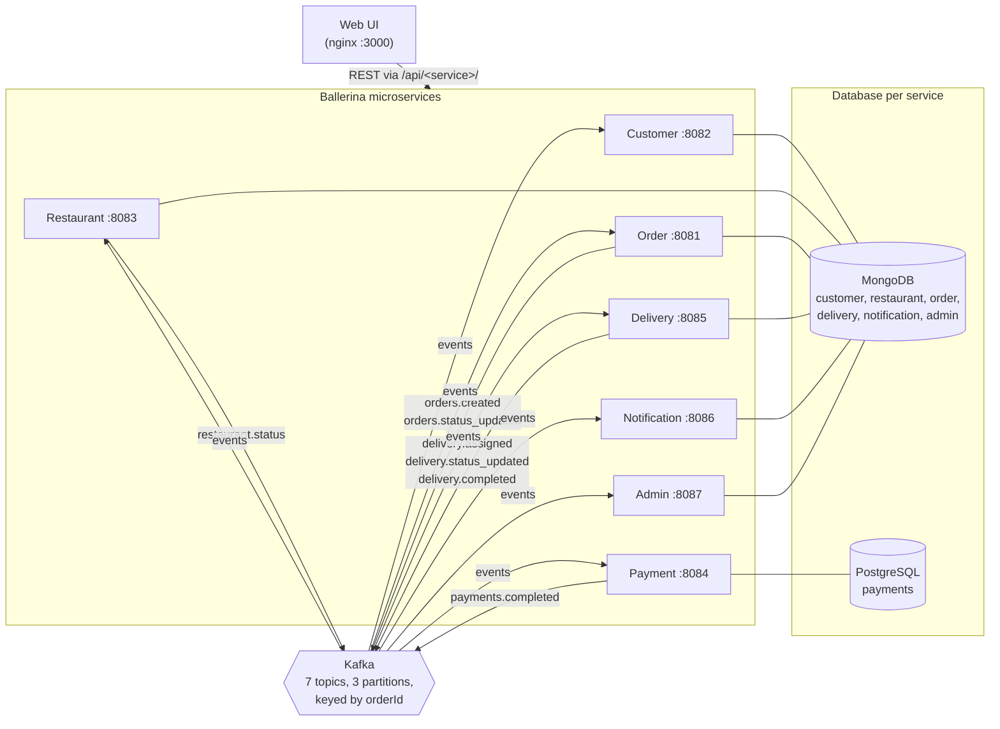

# DSA612S — Distributed Food Delivery Platform

Group assignment: a set of Ballerina microservices communicating over Kafka, run together with Docker Compose, plus a web frontend.

## Repo layout

| Folder                  | Service               | Owner  | Port | Storage     | Status |
|-------------------------|-----------------------|--------|------|-------------|--------|
| `order-service/`        | Order Service         | Jason  | 8081 | MongoDB     | Implemented — see its [README](order-service/README.md) |
| `customer-service/`     | Customer Service      |        | 8082 | MongoDB     | Implemented |
| `restaurant-service/`   | Restaurant Service    | Renate | 8083 | MongoDB     | Implemented — [README](restaurant-service/README.md) |
| `payment-service/`      | Payment Service       | Albert | 8084 | PostgreSQL  | Implemented — [README](payment-service/README.md) |
| `delivery-service/`     | Delivery Service      | Penny  | 8085 | MongoDB     | Implemented — [README](delivery-service/README.md) |
| `notification-service/` | Notification Service  | Gerson | 8086 | MongoDB     | Implemented — [README](notification-service/README.md) |
| `admin-service/`        | Admin Service         | Celine | 8087 | MongoDB     | Implemented — [README](admin-service/README.md) |
| `frontend/`             | Web UI + API proxy    |        | 3000 | –           | Implemented — [README](frontend/README.md) |

Database design (schemas, indexes and why): [DATABASE.md](DATABASE.md).

Each service lives in its own folder with its own `Dockerfile`, and is added to the root `docker-compose.yml` with `build: ./<service-folder>`.

## Running

```
docker compose up -d --build
```

Then open **http://localhost:3000**. On the **System** tab, click **Load demo data** to create two restaurants with menus, a customer and two drivers. Then go through an order:

1. **Customer** – pick a dish, place the order and watch it on *My orders*.
2. **Restaurant** – the order is checked against opening hours and stock and accepted automatically; it moves to *Preparing* once payment clears. Click **Mark ready**. Try **Pause orders** and place another order to see it rejected, cancelled and refunded.
3. **Driver** – the delivery was assigned automatically. Click **Confirm pickup**, then **Start trip**, then **Mark delivered**.
4. **Admin** – see the platform stats update and generate a report.

About 15% of simulated payments fail on purpose. Such an order shows **Retry payment** for the customer.

Compose starts Zookeeper, Kafka, MongoDB and Postgres first. A one-shot `kafka-init` container then creates every topic below. All services wait for it before they start.

To compile all services without Docker, run `.\build.ps1`. It runs `bal build` in each service folder.

To check the whole running stack end to end (all seven services, the Kafka flow, rejection and refunds, notifications, admin stats), run:

```
node scripts/smoke-test.mjs
```

## Architecture



Services never call each other directly: every interaction between them is a Kafka event. The UI talks to each service's REST API through the nginx proxy.

## End-to-end order flow

```
POST /orders ─► orders.created ─┬─► Restaurant: hours + stock OK? ─► restaurant.status ACKNOWLEDGED ─► Order: CREATED → CONFIRMED
                                │      (no: REJECTED + reason ─► Order: → CANCELLED ─► Payment: refund, Delivery: cancel)
                                └─► Payment: charge ─────► payments.completed SUCCESS ──────► Order: CONFIRMED → PREPARING
                                                                     └──────────────────────► Delivery: create + assign driver ─► delivery.assigned
Restaurant: PUT /orders/{id}/status READY
Driver: PUT /deliveries/{id}/status PICKED_UP ─► delivery.status_updated ─► Order: READY → OUT_FOR_DELIVERY
Driver: PUT /deliveries/{id}/status DELIVERED ─► delivery.status_updated ─► Order: OUT_FOR_DELIVERY → DELIVERED
                                               └► delivery.completed (driver freed, next PENDING delivery assigned)
Every topic ─► Notification Service (customer: email+SMS, restaurant: dashboard+email, driver: push+SMS)
            └─► Admin Service (stats / reports)
```

The restaurant's ACK and the payment result can arrive in either order. The Order Service stores `paymentStatus` on the order, and whichever event arrives second moves the order to `PREPARING`. When an order is cancelled (by the customer, the restaurant, or a rejection), the Payment Service refunds any successful payment and the Delivery Service cancels the delivery as long as no driver has picked it up yet. Both services also remember the cancellation, so a payment or delivery event that arrives *after* it can't revive the order.

## Kafka contract (single source of truth)

All topics are keyed by `orderId`, so every event for one order stays on one partition and in order. Consumers use **open records**, so extra fields don't break them. Timestamps are ISO‑8601 UTC strings.

Topics are created by `kafka-init` with **3 partitions** each. Keying by `orderId` spreads different orders across partitions (parallelism), while all events of one order stay in order on one partition.

| Topic | Producer | Consumers | Payload |
|-------|----------|-----------|---------|
| `orders.created` | Order | Customer, Restaurant, Payment, Notification, Admin | `{orderId, customerId, restaurantId, items:[{itemId,name,quantity,unitPrice}], totalAmount, timestamp}` |
| `orders.status_updated` | Order | Customer, Payment, Delivery, Notification, Admin | `{orderId, previousStatus, newStatus, timestamp}` – statuses `CREATED, CONFIRMED, PREPARING, READY, OUT_FOR_DELIVERY, DELIVERED, CANCELLED` |
| `restaurant.status` | Restaurant | Order, Notification | `{restaurantId, orderId, status: "ACKNOWLEDGED" \| "REJECTED", reason \| null, timestamp}` |
| `payments.completed` | Payment | Order, Delivery, Notification, Admin | `{orderId, paymentId, customerId, amount, status: "SUCCESS" \| "FAILED" \| "REFUNDED", timestamp}` |
| `delivery.assigned` | Delivery | Notification, Admin | `{deliveryId, orderId, driverId, timestamp}` |
| `delivery.status_updated` | Delivery | Order | `{deliveryId, orderId, driverId \| null, previousStatus, newStatus, timestamp}` – statuses `PENDING, ASSIGNED, PICKED_UP, IN_PROGRESS, DELIVERED, CANCELLED` |
| `delivery.completed` | Delivery | Notification, Admin | `{deliveryId, orderId, driverId, timestamp}` |

## Health endpoints

| Service | URL |
|---------|-----|
| order, customer, restaurant, delivery, notification | `GET /health` |
| payment | `GET /payments/health` |
| admin | `GET /admin/health` |

The order, customer, restaurant, delivery, notification and admin health responses also list the topics the service consumes. The payment health response only reports status.
